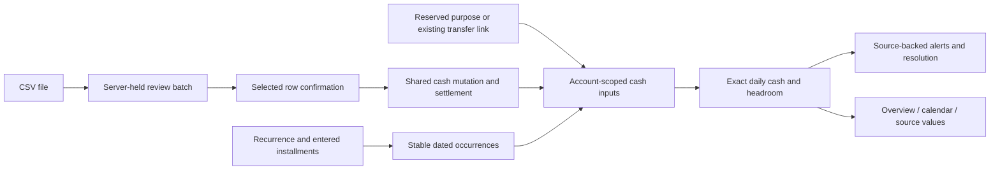

# M2 — Everyday cash input and review

Date: October 2, 2026 (Asia/Bangkok). Status: implemented and locally verified under the owner's request to continue to M2. See [execution evidence](../validation/2026-10-02-m2/README.md) and [release scope](../releases/2026-10-02-m2-everyday-cash-review.md); independent review, remote CI and public rollout remain pending.

## Outcome and acceptance

An owner can review a CSV without posting it, confirm selected server-held rows once, inspect possible duplicates and optionally match imported cash. They can manage recurring and split-date commitments, correct individual occurrences, reserve money for a goal or explicitly link a recorded transfer, enter installments without calculating interest, and inspect the records behind a shortage.

The unblocker is the additive M2 schema and shared mutation contract. Implementation order: schema/scheduling → durable imports → goals/installments → alert reconciliation → frontend tasks → database/browser regression. One implementation thread owns the affected backend/frontend files; accepted public pages, unrelated LINE work and global theme styles are preserved. Independent review and remote CI remain release gates; neither is implied by local self-inspection.

| Decision | Chosen approach | Reason |
| --- | --- | --- |
| CSV source of truth | Server-held batch and immutable normalized rows | Confirmation accepts row IDs/decisions, never a replayed client preview. |
| Duplicate policy | Candidate warnings plus an explicit keep-distinct decision | Equal date/amount/description is not proof of a duplicate. |
| Recurrence identity | Commitment + nominal date + split slot | Different split slots can clamp/shift onto the same date without losing a payment. |
| Horizon extension | Reviewed bounded materialization, insert missing identities only | Edited/cancelled/matched occurrences survive retries and extensions. |
| Goal funding | Reserved purpose versus linked existing transfer | Reserves reduce headroom; a recorded transfer retains its existing cash effect. |
| Installments | Explicit dated amounts, optional reviewed debt link | No inferred interest, principal update or automatic payment. |
| Alerts | Persisted scope, meaningful input fingerprint, source-backed event | Unchanged conditions do not repeat; financial mutations reevaluate registered scopes. |

## Data and API contract

CSV accepts UTF-8 text up to 256 KiB and 500 data rows. Header names are case-insensitive: `date,description,amount,type,currency`, with optional `reference,category`. Dates are ISO calendar dates, positive amounts have at most two decimals, type is income/expense and each row's currency must equal the explicitly confirmed workspace currency. All rows target one selected active cash account. Invalid rows remain visible and cannot be posted. Candidate matches are suggestions; selection and amount are reviewed explicitly. Confirmation, postings and selected matches are one audited transaction; any invalid/stale choice rolls all of them back. An already posted row cannot be posted again even after its record is reversed.

Recurrence supports once, weekly, biweekly, monthly, quarterly, yearly and split monthly days, with an explicit interval multiplier and existing weekend rules. A split amount is **per scheduled occurrence**. Month-end clamping retains distinct slots; weekend shifts can cross the nominal schedule boundary. An occurrence edit can change expected/due date, amount, title or cancellation; its amount cannot be reduced below active settlements. Generation preserves those exceptions. The initial horizon remains bounded; a reviewed extension is available through 2100 with a per-call row cap.

Goal allocations use exact amounts, an account, optional owned legacy goal and explicit currency confirmation. Reserved allocations do not create movements or change legacy savings progress. A transferred allocation links an already recorded same-currency owner transfer and does not reserve it again, initiate money movement or update legacy goal progress. Releasing an allocation does not reverse its transfer. Entered installment schedules create one linked commitment and dated occurrences; only those occurrences enter cash forecasts. An optional debt link is owner-checked and currency-confirmed; recorded expense/matching does not alter debt principal.

Alerts include scope, period, currency, event date, meaningful input version/fingerprint, cash/buffer/reserved amounts, sources, assumptions and missing-data warnings. Negative cash, below-buffer, reserved-money gap and incomplete-input alerts are distinct. Acknowledgment is metadata, not a financial correction. The 20 most recently evaluated scopes refresh inside financial mutations; removed/changed conditions resolve their alerts. Older scopes retain their dated history and refresh on revisit. New date ranges do not exhaust the workspace. No external channel is connected.

All mutations retain M1 owner authorization, expected revisions, stable retry keys and audits. Upload review, alert acknowledgment/evaluation and scenario metadata do not change the cash-input base revision. New endpoints remain behind the existing cash-workspace flag. Finance integrity checks remain active if exposure is disabled.

## Migration and rollback

Revision `a1002cf00002` extends `a1002cf00001` additively. Existing rows retain IDs, amounts, source links, settlements and cancellation/date exceptions. New recurrence fields receive legacy-compatible defaults. The occurrence uniqueness constraint gains a split slot; existing slots are zero. SQLite uses batch mode; PostgreSQL is rehearsed separately. Populated M2 metadata/history refuses destructive downgrade. Application rollback retains the schema and uses compatible code or disables exposure. No production database migration is authorized by this local implementation.

## Verification

Cover CSV malformed rows, cents/dates/currencies, owner/account isolation, tampered confirmation payloads, duplicates within/across batches, same-key and new-key retries, concurrent confirmation, reversal and optional partial matching. Cover every recurrence interval, leap/month-end split collisions, weekend boundary shifts, extensions preserving edited/cancelled/matched rows and source-link rejection. Verify reserves versus transfers, selected-account scope, explicit debt entries and unchanged legacy principal/progress. Verify alert deduplication, acknowledgment, source dates, missing data, resolution and scoped stale state. Exercise these real API tasks with keyboard and 320/390px screens; preserve M0–M1 examples and legacy regressions.

Public deployment, bank import formats beyond the documented CSV, team roles, M3 business documents/snapshots, interest/tax calculations and M4 chat delivery remain outside M2.
