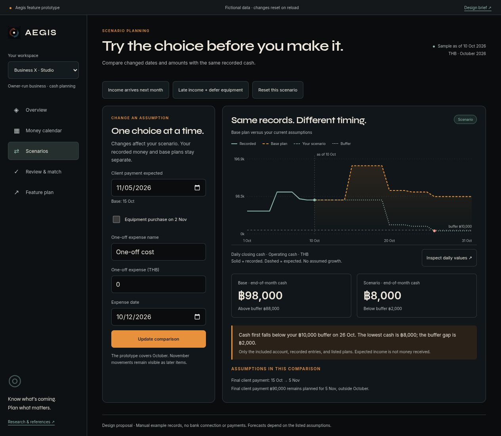

# Personal and business cash-flow design verification

Checked October 1, 2026, approximately 22:10 Asia/Bangkok. Scope: new isolated static design prototype and its fictional calculation model. This is not implementation, migration, production API, integration or customer-usability verification.

Live local review: **http://127.0.0.1:3105/**. [Design brief](../../design/2026-10-01-cashflow-workspaces/proposal.md) · [reference research](../../design/2026-10-01-cashflow-workspaces/references.md).

## Checks actually performed

- Ten meaningful calculation tests passed. [Raw result](model-tests.log) covers both accepted stories, low cash before a positive month end, late receipts, deferred equipment, full and partial matching, unchanged fixture source, a transfer between included accounts versus a sending-only scope, future actual exclusion, mixed currency rejection and invalid scenario input. These do not cover a full production ledger/recurrence/accounting implementation.
- Desktop at the browser's default 1280 × 720: correct baseline values, loaded local fonts, original icon, no horizontal page overflow. No reference screenshot pixels were copied from competitors.
- Personal purchase: −500 cash on 16 Oct and 3,900 closing cash; the explanation explicitly distinguishes the earlier negative date from month end. A chart-axis label initially rounded this small negative value to `0k`; formatting with one decimal preserves `−0.5k`. The corrected page was reloaded and captured.
- Scenario form: a draft amount `1234.56`, title `Camera repair`, and date `2026-10-22` survived changing views and switching workspaces. Submitting produced 47,665.44 closing cash and 42,665.44 above the buffer. Applying a scenario did not change base records.
- Business late receipt: 8,000 cash, 2,000 buffer gap from 26 Oct; no negative-cash claim. Deferring equipment additionally produced 20,000 cash, retained both later November items, and removed the October buffer breach.
- Calendar: selected 26 Oct under the equipment-deferral scenario showed no new movement and 20,000 cash. Table retained equipment due 26 Oct / expected 2 Nov and invoice due 8 Oct / expected 5 Nov. Inspecting the source entry showed these dates and outstanding 90,000; Escape closed the dialog and returned focus to its trigger.
- Business sample matching: confirmation preview showed cash 89,000→24,000, future cost removed 65,000 and closing 98,000 unchanged. Confirming produced four recorded rows with a linked contractor record, a single Undo action and returned focus. Base overview and the 31-row daily-values table agreed on closing 98,000. Undo was exercised separately and restored the original three recorded rows and pending-review state.
- Phone at 390 × 844: actual `innerWidth` 390, document width 375; personal overview and calendar had no horizontal page overflow. Calendar contained 31 dates. Daily-values dialog width 337 / x19 fit the viewport and closed with Escape. The side navigation intentionally scrolls horizontally on small screens; the page itself does not.
- Narrow 320 × 740: actual width 320 / document 305. Scenario and feature-plan layouts had no page overflow. Personal match dialog width 267 / x19 fit; confirming updated cash 45,800 and retained closing 48,900. Six linked reference cards were present.
- Returning to Overview moved focus to its heading; Tab reached Base plan. The native dialog and buttons retain keyboard behavior. Computed text/action colors were inspected: muted label `rgb(181,187,185)` on card `rgb(16,22,25)` and action ink `rgb(24,29,32)` on amber `rgb(232,145,60)`. This limited inspection is not a complete accessibility certification.
- [Fresh prototype console](console.json) contained no error/warning messages. After the final model scope change, baseline and late-business scenario were checked again; screenshots were updated. The viewport override was reset and Business X's clean base Overview was left open as the deliverable.
- [Manifest](prototype-manifest.json) records file hashes and matching local HTTP bytes. Source syntax checks and `git diff --check` passed. The calculation tests were rerun after the account-scope change; unrelated application tests/builds were not rerun for this isolated design.

## Visual evidence

| Screenshot | Observed state |
| --- | --- |
| [personal-desktop.png](personal-desktop.png) | Personal base overview at default desktop viewport |
| [business-desktop.png](business-desktop.png) | Business X base overview |
| [personal-purchase-scenario.png](personal-purchase-scenario.png) | Positive month end with an earlier negative cash date |
| [business-late-payment.png](business-late-payment.png) | Late receipt, unchanged base and explicit buffer gap |
| [business-calendar.png](business-calendar.png) | Calendar and day selection under the deferral scenario |
| [business-match-review.png](business-match-review.png) | Review confirmation before recording the sample match |
| [personal-mobile.png](personal-mobile.png) | Personal overview at 390 × 844 |
| [personal-calendar-mobile.png](personal-calendar-mobile.png) | Calendar at 390 × 844 |



## Reproduce the local board

The user service `aegis-cashflow-workspaces-preview.service` runs Python's static HTTP server bound to 127.0.0.1:3105, working directory `/mnt/data/company/apps/Aegis/docs/design/2026-10-01-cashflow-workspaces`. Recheck the listener/unit before starting another preview; do not replace the landing preview or app service by assumption.

Run the calculation checks from the repository with:

```sh
node --test docs/design/2026-10-01-cashflow-workspaces/model.test.mjs
```

Reload resets the fictional prototype. No application API is imported or called by its source; real accounts, provider messages, transactions and published landing are untouched. This source-inspection boundary is distinct from a captured production network test. Physical phones, other browser engines, full accessibility and real customer comprehension were not tested.

## Learning/reuse scope

The Aegis design skill and earlier cash-flow proposal were substantively retrieved and reused. Their distinctions between cash, plans, reserves, and hypothetical edits guided the prototype and its acceptance examples. The new proposal expands the requested product design to personal and business workspaces without declaring that business features are already shipped. No counterfactual time or quality gain was measured.

The Aegis skill's retrieval checkpoint now points to this dated design and evidence. This is a small reversible local learning update, not a change to the accepted visual contract or to authorization. Its prior version was saved at `/home/santapong/.codex/learning/backups/2026-10-01-aegis-cashflow-checkpoint.md`. Future retrieval must recheck preview processes, repository state and implementation status; owner acceptance and production delivery remain pending.
