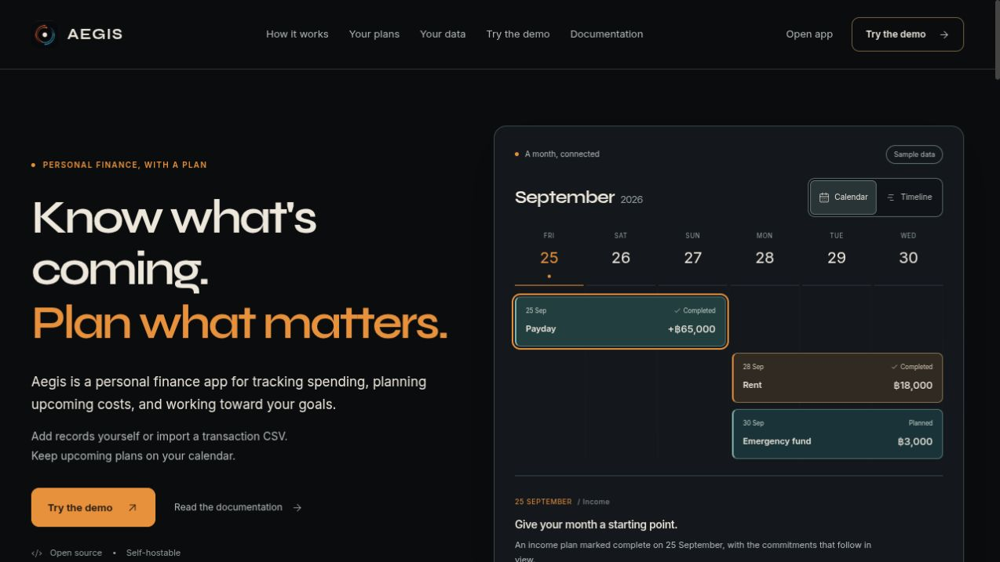

# Public landing release evidence

Checked October 1, 2026, Asia/Bangkok. [Release notes and reproduction](../../deployment/landing-first-2026-10-01.md).

Live: https://draveniq-aegis-landing.vercel.app

| Evidence | Scope |
| --- | --- |
| [deployment.json](deployment.json) | CLI result: production READY and URLs |
| [source-manifest.json](source-manifest.json) | 40 reviewed frozen source entries, branch/base and hashes |
| [artifact-manifest.json](artifact-manifest.json) | 74 static files and hashes |
| [upload-dry-run.json](upload-dry-run.json) | Actual prebuilt upload list |
| [build.log](build.log) | Successful build, type checking and static export |
| [production-http-checks.json](production-http-checks.json) | 22 public 200 responses matching frozen bytes; three expected 404s |
| [production-console.json](production-console.json) | No captured error/warning messages during the checked live flow |
| [production-desktop.png](production-desktop.png) | Live root at default 1280 × 720 viewport |
| [production-mobile.png](production-mobile.png) | Live root at 390 × 844 |
| [production-demo.png](production-demo.png) | Live fictional payment-delay scenario |
| [production-docs.png](production-docs.png) | Live transaction guide reached through search |

These artifacts are dated observations, not a continuing uptime monitor. The hosted application, account writes and integrations were outside this public static deployment.
